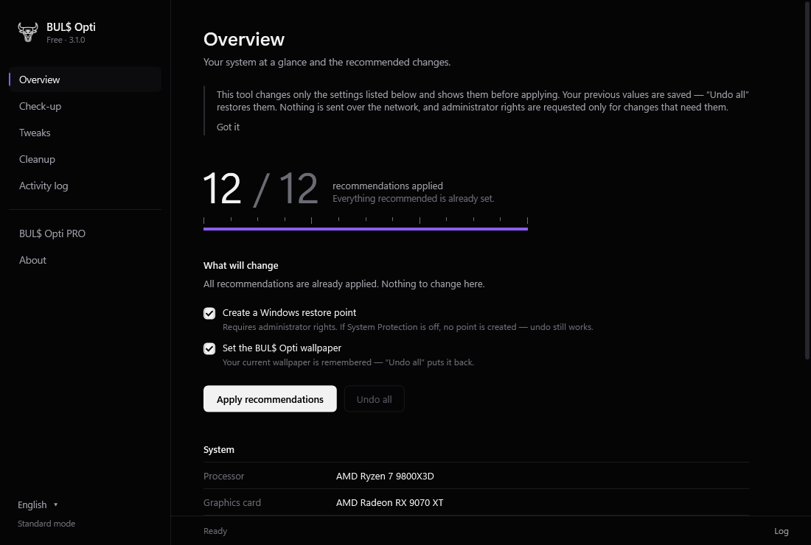
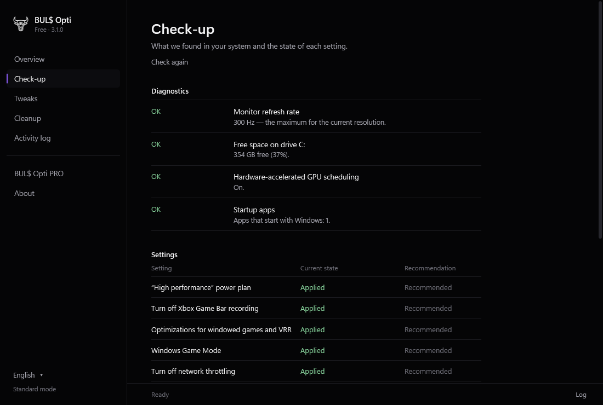

<div align="center">


# FPS-TOOL — BUL$ Opti Free

**A free, open-source tweaker for gaming PCs on Windows.**
Shows exactly what it will change before it changes anything, keeps your previous values, and puts them back with one button.

`3.1` · `WPF` · `C# 5 / .NET Framework 4` · no third-party code · MIT

</div>

---

## What it does

| Section | |
|---|---|
| **Overview** | How many recommendations are already applied, the list of what will change, your hardware at a glance and a quick temp-file cleanup with an all-time counter. |
| **Check-up** | Real problems on your PC: monitor running below its max refresh rate, low disk space, a pending Windows restart, GPU scheduling, startup apps — plus the current state of every setting. |
| **Tweaks** | 14 tweaks with presets (Recommended, For gaming, Responsiveness). Each one shows its risk and the exact registry value: current → new. Turning a tweak off restores your previous value. |
| **Cleanup** | 10 categories with sizes: temp files, browser cache, DNS, Recycle Bin, GPU shader cache, thumbnails, Windows Update and Delivery Optimization caches, crash dumps, old logs. Risky ones are off by default and explained. |
| **Activity log** | Everything the tool did, also saved to `%LOCALAPPDATA%\BULS Opti\log.txt`. |
| **BUL$ Opti PRO** | A page about the separate paid app. This free tool doesn't replace or unlock it. |

Languages: English (default), Русский, Українська, Deutsch, Español, Português, Türkçe, Polski.

## Screenshots

| Overview | Check-up |
|---|---|
|  |  |

| Tweaks | Cleanup |
|---|---|
|  |  |

## Safety

- **Starts without admin rights.** It asks for them only right before a change that needs them, lists why, then restarts elevated and continues.
- **Undo all** restores the values *you* had before — not Windows defaults. They're saved under `HKCU\Software\BULS Opti\Undo` before the first change.
- Creates a Windows restore point (native API) when System Protection is on.
- Cleanup never follows folder links (junctions/symlinks), skips files in use, removes temp files only when they're older than a day, and asks before touching a non-standard `%TEMP%` or the Recycle Bin.
- No external processes, no network calls, no services, no scheduled tasks, no autostart.
- Doesn't touch Defender, the firewall, Windows Update, services or the page file.

The optional BUL$ Opti wallpaper is a visible checkbox; your previous wallpaper comes back with **Undo all**.

## Build

Only Windows is needed — the C# compiler ships with .NET Framework 4.

```powershell
cd src
.\build.ps1            # release: BulsOptiFree.exe
.\build.ps1 -Preview   # no manifest, for rendering screens
.\preview.exe screenshot out.png overview en   # draws a screen to PNG without changing anything
```

The `.exe` isn't code-signed, so SmartScreen may show "unknown publisher" on first run (More info → Run anyway). The download on [bulsopti.com/free](https://bulsopti.com/free) is built from this source.

## Layout

```
src/
  Engine.cs     tweaks, undo journal, power plan, restore point, system info, diagnostics
  Clean.cs      cleanup categories and a safe folder walker
  Loc.cs        all UI strings in 8 languages
  Ui.cs         theme and control templates
  App.cs        window, pages, dialogs, elevation
  build.ps1     build script
screenshots/
```

## License

[MIT](LICENSE) · © 2026 BUL$ Opti · [bulsopti.com](https://bulsopti.com)
