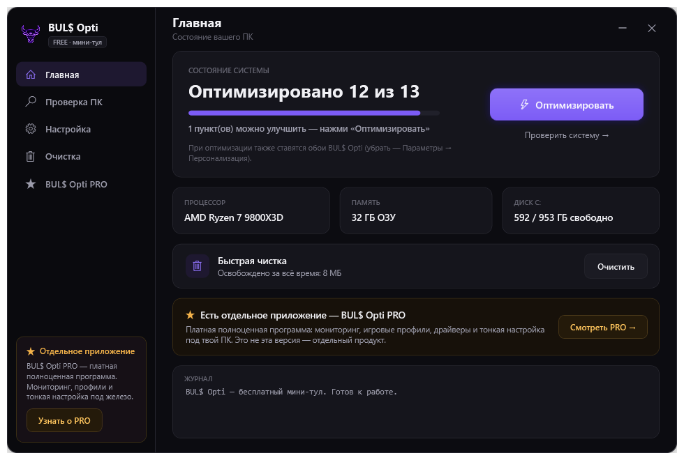
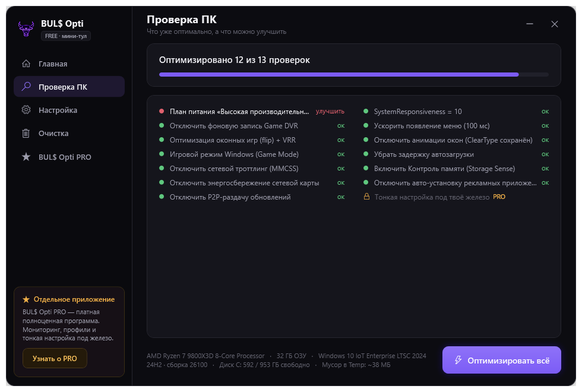
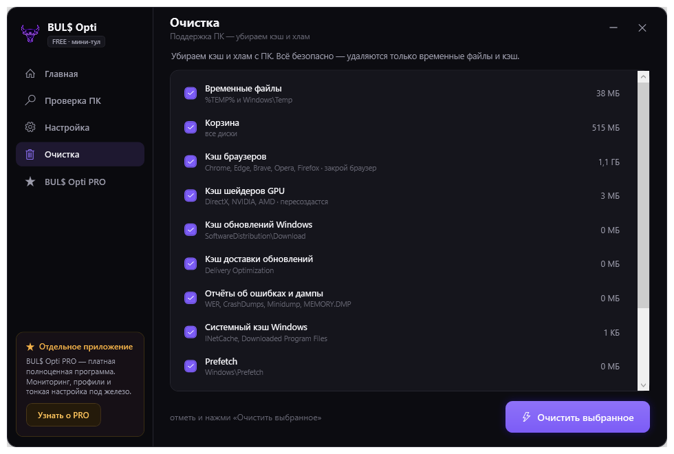
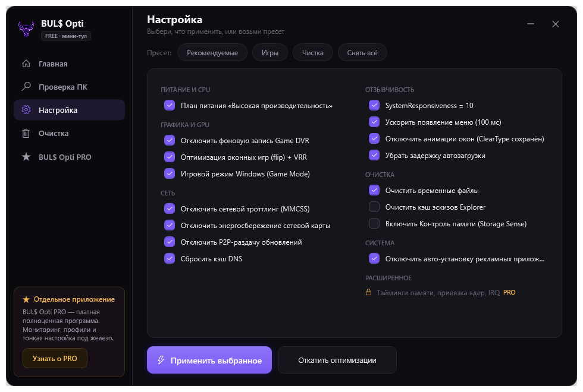
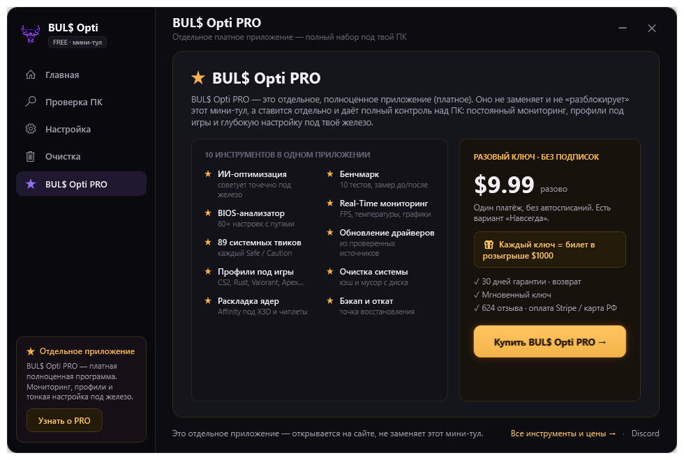

<div align="center">


# FPS-TOOL — BUL$ Opti

**Бесплатный мини-оптимизатор игрового ПК под Windows.**
Одна кнопка — набор безопасных, **полностью обратимых** твиков, проверка системы и глубокая очистка от кэша и хлама.

`WPF` · `C# (.NET Framework 4)` · без сторонних зависимостей · открытый код

</div>

---

## Что умеет

| Раздел | Описание |
|---|---|
| **Главная** | Оценка состояния ПК, оптимизация в один клик, быстрая чистка со счётчиком «освобождено за всё время», сводка по железу. |
| **Проверка ПК** | Читает реальное состояние системы и показывает, что уже оптимально, а что можно улучшить (13 проверок) + характеристики железа. |
| **Настройка** | 16 твиков вручную с пресетами (Рекомендуемые / Игры / Чистка). У каждого — описание и уровень риска. |
| **Очистка** | Поддержка ПК: 12 категорий кэша и хлама с реальными размерами — temp, корзина, кэш браузеров, шейдеры GPU, обновления Windows, дампы, логи и др. |
| **PRO** | Витрина платного приложения [BUL$ Opti PRO](https://www.bulsopti.com/app) — отдельного продукта с мониторингом, профилями под игры, BIOS-анализом и тонкой настройкой. |

## Скриншоты

| Главная | Проверка ПК |
|---|---|
|  |  |

| Очистка | Настройка |
|---|---|
|  |  |

<div align="center">



</div>

## Безопасность

- Перед применением создаётся **точка восстановления Windows** (родной системный вызов, без запуска сторонних процессов).
- Бэкап изменяемых веток реестра сохраняется в `Документы\BULS Opti Backups`.
- Кнопка **«Откатить оптимизации»** возвращает твики к значениям по умолчанию.
- **Не трогает:** Защитник, брандмауэр, обновления, службы, файл подкачки.
- Никакой телеметрии, сети и скрытых действий — код открыт, читайте [`src/Program.cs`](src/Program.cs).

При авто-оптимизации на рабочий стол также ставятся обои BUL$ Opti (убираются через Параметры Windows → Персонализация).

## Сборка из исходников

Нужен только Windows — компилятор C# (`csc`) уже входит в состав .NET Framework 4.

```bat
cd src
build.cmd
```

Соберётся `BULS Opti Optimizer.exe` — приложение запускается с правами администратора (требуется для системных твиков).

> `.exe` не подписан цифровой подписью, поэтому при первом запуске SmartScreen может показать «неизвестный издатель» — это нормально для неподписанных сборок («Подробнее» → «Выполнить в любом случае»).

## Структура

```
FPS-TOOL/
├─ src/                 исходники C# (WPF, без XAML)
│  ├─ App.cs            интерфейс: боковое меню, экраны, логика
│  ├─ Program.cs        движок: твики, скан, очистка, бэкап
│  ├─ AssemblyInfo.cs   метаданные версии
│  ├─ app.manifest      запрос прав администратора
│  ├─ build.cmd         сборка одной командой
│  └─ *.png, *.ico      ресурсы (логотип, обои, иконка)
├─ screenshots/         скриншоты интерфейса
├─ LICENSE              MIT
└─ README.md
```

## Лицензия

[MIT](LICENSE) · © 2026 BUL$ Opti · [bulsopti.com](https://bulsopti.com)
